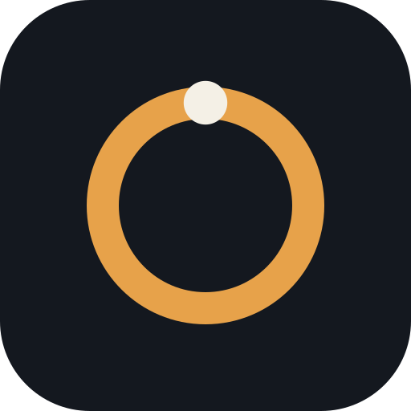
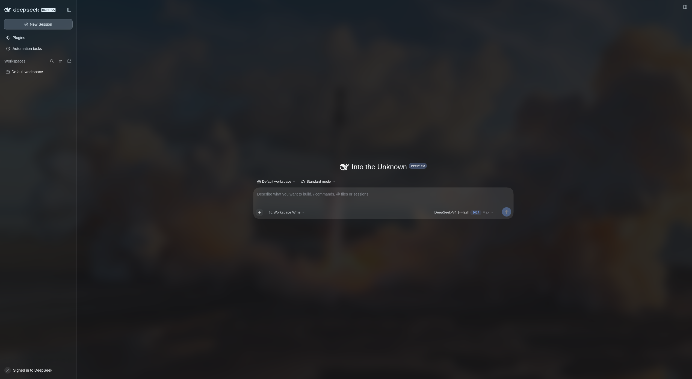

# dsh-linux

Unofficial Linux desktop, built on [DeepSeek Harness](https://github.com/deepseek-ai/deepseek-harness).

Not affiliated with, endorsed by, or maintained by DeepSeek. This is not an official port. The icon is an original mark, not a DeepSeek logo.

The shell is Electron. It boots the published `web` profile of `@deepseek-ai/dsh` and does not fork the harness. Sessions are the same `~/.dsh` profile as a terminal `dsh web`. Provider keys stay in the harness credential file. This window does not read that file.



## Install

Node 24 or newer. This package is not published to npm. Clone it.

```sh
git clone https://github.com/FirstIntegral/dsh-linux.git
cd dsh-linux
npm install
bin/dsh-linux
bin/install-desktop.sh
```

`--port <n>` or `DSH_LINUX_PORT` chooses the port. The default is 3080.

A black window: quit, then `bin/dsh-linux --ozone-platform=x11`. Still black: add `--disable-gpu`.

## What you get

- Pinned CLI `@deepseek-ai/dsh@0.2.1-rc.2`, started as `web --no-open`
- Sandboxed window that stays on the loopback origin
- Account sign-in in a popup. Other web links open in the system browser
- A menu entry and an original icon from `bin/install-desktop.sh`

There is no AppImage. The shell needs system Node and your `~/.dsh`.

Boot contract, pins, and the key boundary: [docs/BOOT.md](docs/BOOT.md).

## License

MIT, copyright brwsk. The harness stays an npm dependency, MIT, copyright DeepSeek.
